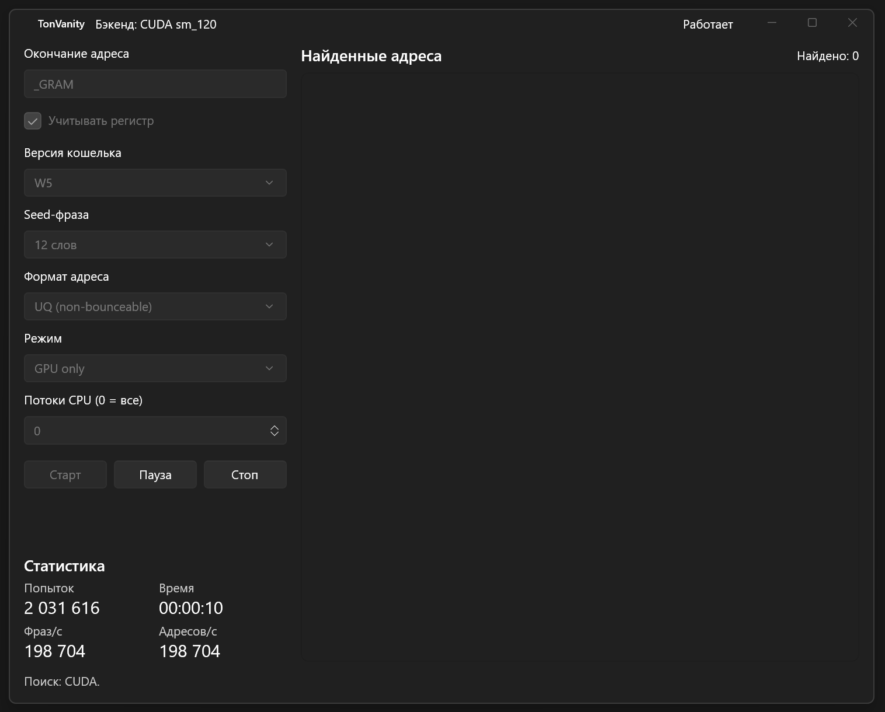

# TonVanity — GPU-генератор TON-адресов



Генератор TON-адресов на CUDA, OpenCL и CPU. Поддерживает seed-фразы из 12 и 24 слов, кошельки W5, V4R2 и TGWallet.

## ⚠️ Безопасность

- Приложение работает полностью офлайн и не делает сетевых запросов.
- Seed-фразы и приватные ключи не покидают ваш ПК.
- Найденные адреса и сид-фразы сохраняются только локально — в `found.txt` рядом с приложением.

## Возможности

- Бэкенды: CUDA (sm_75/86/89/120), OpenCL и CPU.
- Режимы: CPU, CPU+GPU, GPU only.
- Seed-фразы: 12 или 24 слова.
- Кошельки: W5, V4R2, TGWallet.
- Форматы адресов: UQ (non-bounceable) и EQ (bounceable).
- Поиск по окончанию адреса, с учётом регистра.
- Статистика: попытки, время, фраз/с, адресов/с.

## Запуск

Windows 10/11 x64. Установка .NET и Windows App SDK не требуется — сборка self-contained.

- Консоль: [TonVanity.exe](TonVanity.exe)
- GUI: [TonVanity WinUI/TonVanity.exe](TonVanity%20WinUI/TonVanity.exe)

## Сборка

Исходники — в ветке [source](https://github.com/QuirkyTroll/TonVanity/tree/source).

Требования:

- [.NET 8 SDK](https://dotnet.microsoft.com/download/dotnet/8.0) — для WinUI 3.
- [CUDA Toolkit 12.x](https://developer.nvidia.com/cuda-downloads) — `nvrtc`, `nvcc`/`ptxas`, `cudart64_12.dll`.
- MinGW-w64 ([w64devkit](https://github.com/skeeto/w64devkit)) — `g++` и `windres`.
- Python 3 — для бутстрапа тулчейна.

```powershell
git clone -b source https://github.com/QuirkyTroll/TonVanity.git TonVanity-src
cd TonVanity-src
.\build.ps1
```

Первый запуск — с интернетом; повторная сборка — `.\build.ps1 -Offline`. Скрипт собирает `tonvanity.dll`, консольный `TonVanity.exe` и WinUI 3 UI в соседнюю папку `TonVanity/`.

## Лицензия

MIT — см. [LICENSE](LICENSE).
